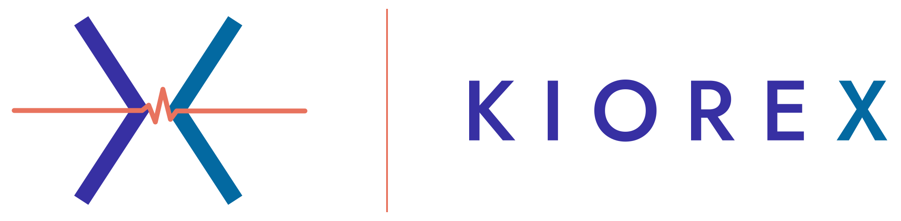
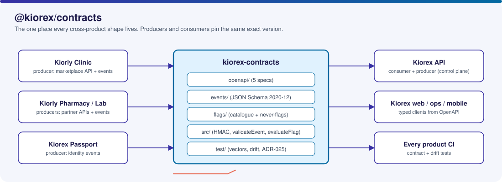
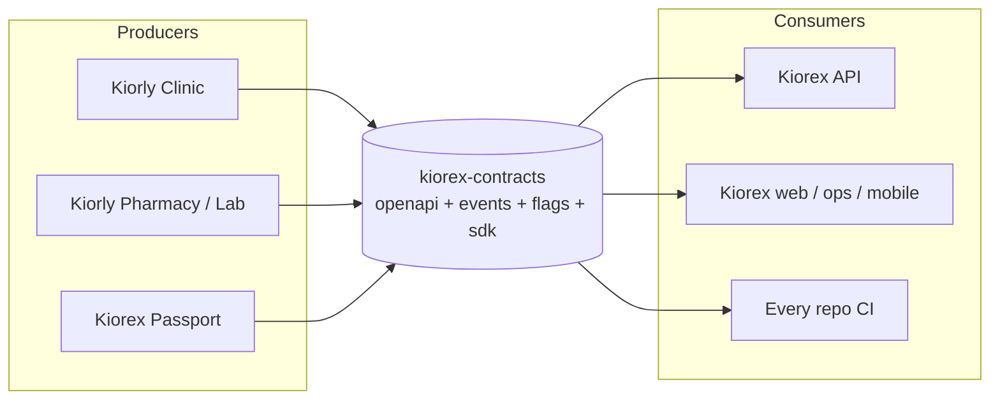
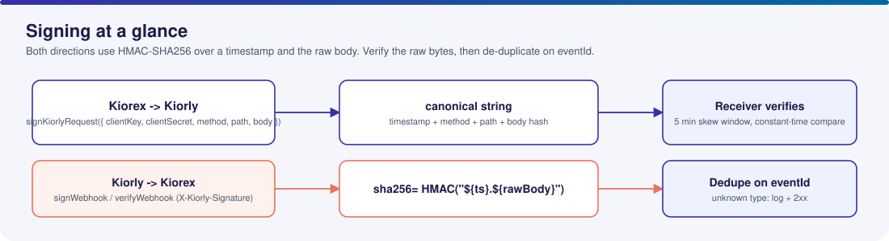
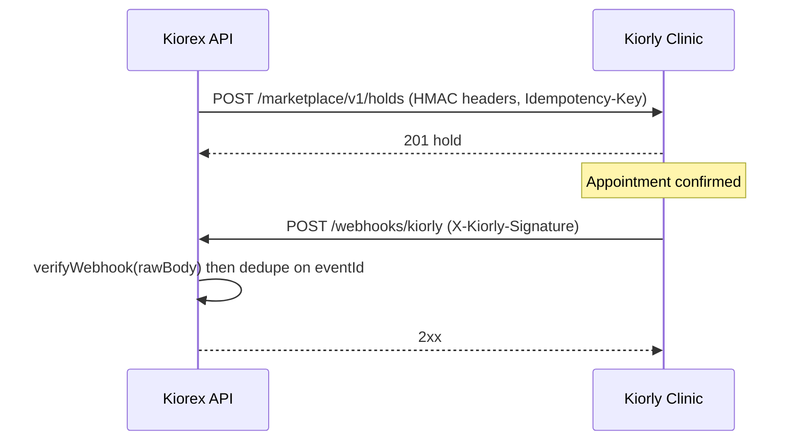
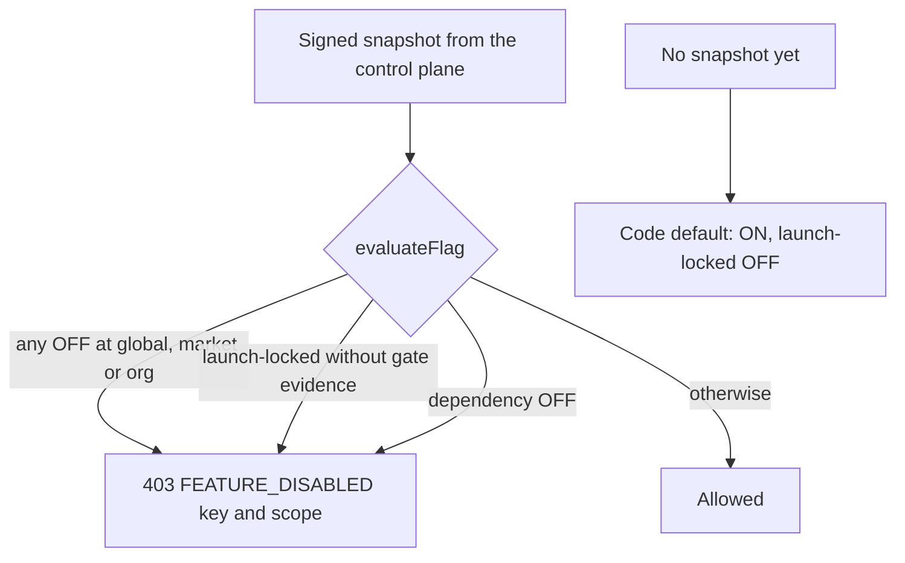

<div align="center">



# @kiorex/contracts

**The single source of truth for everything that crosses a product boundary in Kiorex v2.**
OpenAPI, event JSON Schemas, feature-flag catalogue, HMAC helpers and a typed TypeScript SDK.


[Quick start](#quick-start) · [Diagrams](#how-it-fits) · [Contents](#whats-inside) · [Docs](#where-to-read-next) · [Ecosystem map](https://github.com/mshall/kiorex-workspace)

</div>

> **Synthetic data only.** QA fixtures and dev logins are listed in [TEST_DATA.md](TEST_DATA.md) (DEV ONLY).

---

## What and why

Kiorex v2 is several products (Kiorex marketplace, Kiorex Passport, Kiorly Clinic, Pharmacy, Lab) built in separate repositories. They never share a database and never import each other's source. Instead they speak **signed HTTP and webhooks** whose shapes are defined here, once, and versioned. This repo is that shared language: producers validate what they send, consumers validate what they receive, and CI on both sides fails when a contract drifts (KX-09, ADR-023..025).



## At a glance

| | |
|---|---|
| **Package** | `@kiorex/contracts` 1.6.0 (ESM + CJS + `.d.ts`) |
| **OpenAPI specs** | 5 (Kiorly marketplace 1.3.0, control plane 1.0.0, webhooks 1.1.0, pharmacy 0.1.0 draft, lab 0.3.0 draft) |
| **Event schemas** | 46 types plus the envelope, JSON Schema 2020-12, with examples |
| **Feature flags** | 57 catalogued (classes: Module, Commercial, Integration, AI, Launch-locked) |
| **Helpers** | `signKiorlyRequest`, `verifyKiorlyRequest`, `signWebhook`, `verifyWebhook`, `validateEvent`, `evaluateFlag`, `featureDisabledBody`, typed `FLAGS` |
| **Distribution** | Vendored tarball today (`npm run pack:local`); GitHub Packages publish needs founder approval |
| **Rule of thumb** | Additive = minor. Remove, rename or tighten = major, with a 90-day parallel run |

## How it fits



### Signing a request and a webhook





### How a flag is decided



## What's inside

| Path | What | Status |
|---|---|---|
| `openapi/kiorly-marketplace.v1.openapi.json` | Kiorly Clinic marketplace API (Kiorly stays the producer) | :white_check_mark: 1.3.0 |
| `consumer/kiorex-consumer-contract.json` | Kiorex's consumer-driven expectations of that API | :white_check_mark: |
| `openapi/kiorex-control-plane.v1.openapi.json` | Flag snapshot (HMAC, ETag/304), `flag.changed` push, universal `403 FEATURE_DISABLED` | :white_check_mark: 1.0.0 |
| `openapi/kiorex-webhooks.v1.openapi.json` | Kiorly to Kiorex receiver, PSP webhook shape, OIDC back-channel logout | :white_check_mark: 1.1.0 |
| `openapi/kiorly-pharmacy.v1.openapi.json` | Kiorex to Pharmacy machine API | :construction: draft, reconciled with the running service |
| `openapi/kiorly-lab.v1.openapi.json` | Kiorex to Lab machine API (incl. nurse sample custody) | :construction: draft 0.3.0 |
| `events/*.schema.json` + `examples/` | Envelope plus one schema per event | :white_check_mark: |
| `flags/catalogue.json`, `flags/safety-never-flags.json` | KX-08 flag catalogue; ADR-025 never-a-flag list | :white_check_mark: |
| `fixtures/` | Example JSON for Rev 2.3 events and personas (tested, not shipped) | :test_tube: |
| `src/` | Types, `validateEvent`, HMAC helpers, `evaluateFlag`, typed `FLAGS` | :white_check_mark: |

## Quick start

```bash
cd kiorex-contracts
npm install
npm run generate     # events/, flags TS and OpenAPI types from their sources
npm test             # schemas, examples, HMAC vectors, flag rules, ADR-025, consumer drift
npm run build        # generate + tsup (ESM, CJS, d.ts)
npm run pack:local   # dist-pack/kiorex-contracts-<version>.tgz for sibling repos
```

```ts
import { verifyWebhook, validateEvent, evaluateFlag, featureDisabledBody, FLAGS } from "@kiorex/contracts";

const ok = verifyWebhook({ secret, body: rawBody, timestamp, signature });   // verify the RAW body
const parsed = validateEvent(envelope.type, envelope);                       // unknown type => { valid:false }, log + 2xx
const d = evaluateFlag(snapshot, FLAGS.KIOREX_MARKETPLACE, { market: "EG", orgId });
if (!d.enabled) throw new ForbiddenException(featureDisabledBody(d));        // 403 FEATURE_DISABLED
```

More examples, `file:` tarball consumption, and the release steps: [docs/USAGE.md](docs/USAGE.md).

## Tests and requirements

| Command | Checks |
|---|---|
| `npm run lint` | `tsc --noEmit` |
| `npm test` | Vitest: event schemas and examples, HMAC vectors (produced by running Kiorly's own functions), flag evaluation, flag catalogue, OpenAPI drift, ADR-025 |
| `npm run generate` then `git diff --exit-code` | CI fails when generated files are stale |

Requires Node 22 or newer. Event schemas are edited **only** in `scripts/event-defs.mjs`; the marketplace OpenAPI and consumer contract are copies of Kiorly's files, so change them in `clinics-management` first, then re-copy and bump the version.

## Folder map

```text
kiorex-contracts/
├── openapi/      5 OpenAPI 3 files
├── events/       envelope + 46 event schemas, examples/
├── flags/        catalogue.json, safety-never-flags.json
├── consumer/     Kiorex consumer-driven contract
├── fixtures/     example payloads (tests only)
├── src/          SDK: hmac, validateEvent, evaluateFlag, FLAGS, generated types
├── scripts/      event-defs.mjs (source of events), generators
├── test/         vitest suites + hmac-vectors.json
├── docs/         INDEX, USAGE, EVENTS, FLAGS, assets/
└── CHANGELOG.md  where Kiorly's code differs from KX-09
```

## Versioning rules

<details>
<summary><b>Pinning, semver and the 90-day rule</b></summary>

- **Pin an exact version** (no `^` or `~`) in every repo. Upgrades are an explicit PR that runs that repo's contract tests.
- Additive change (optional field, new event, new endpoint) = **minor**. Removing or renaming a field, event type, path or enum value, or tightening a schema = **major**. Docs or bugfix = patch.
- A major change keeps the old contract working in parallel for **90 days**. Consumers tolerate unknown fields and event types; `data` schemas never set `additionalProperties: false`.
- Breaking a published contract needs a human decision.
- Producers validate outgoing payloads in non-production; consumers validate on receipt.
</details>

<details>
<summary><b>Standing rules that apply here</b></summary>

- No tax-authority reporting in any product (ADR-011): no schema, event or endpoint for it exists here, and a repo test in the products fails if one appears.
- Providers (messaging, PSP, video, AI) are mocked for now; contracts describe the real shapes, adapters stay `MODE=mock` by default.
- Safety controls are never flags (ADR-025); the list lives in `flags/safety-never-flags.json` and CI rejects a flag that gates one.
</details>

## Security notes

- HMAC verification must use the **raw** request body and a constant-time compare; timestamps outside the skew window are rejected.
- Nothing secret lives in this repo. Dev client keys and webhook secrets for local runs are documented in the workspace `INTEGRATION.md` (dev only, rotate everything for staging and production).
- Package tokens (`read:packages`) are never committed; `.npmrc` uses `${NODE_AUTH_TOKEN}`.

## Where to read next

| Read | For |
|---|---|
| [docs/INDEX.md](docs/INDEX.md) | Index of everything in this repo |
| [docs/USAGE.md](docs/USAGE.md) | Imports, pinning, tarball use, releasing |
| [docs/EVENTS.md](docs/EVENTS.md) | Event catalogue |
| [docs/FLAGS.md](docs/FLAGS.md) | Flag catalogue |
| [CHANGELOG.md](CHANGELOG.md) | Version history |
| [TEST_DATA.md](TEST_DATA.md) | Synthetic fixtures |
| [Workspace README](https://github.com/mshall/kiorex-workspace) | Ecosystem map, ports, one-command start |

## Contributing

`main` is the working branch. Use Conventional Commits with requirement IDs (for example `feat(events): KXM-BK-03 add field`). Update `CHANGELOG.md`, bump the version by the semver rule, run `npm test` and `npm run generate`. Do not publish: the `publish` workflow is manual and needs founder approval.

## Glossary

| Term | Meaning |
|---|---|
| **HMAC** | Keyed hash signature on a request or webhook |
| **Outbox** | Transactional table that guarantees an event is delivered at least once |
| **Envelope** | Common wrapper for all events (`eventId`, `type`, `occurredAt`, `data`) |
| **Control plane** | Kiorex super admin that owns feature flags |
| **Launch-locked** | Flag that is effective only after a human records gate evidence |

<div align="center"><sub>Private repository. Part of <a href="../README.md">Kiorex v2</a>.</sub></div>
