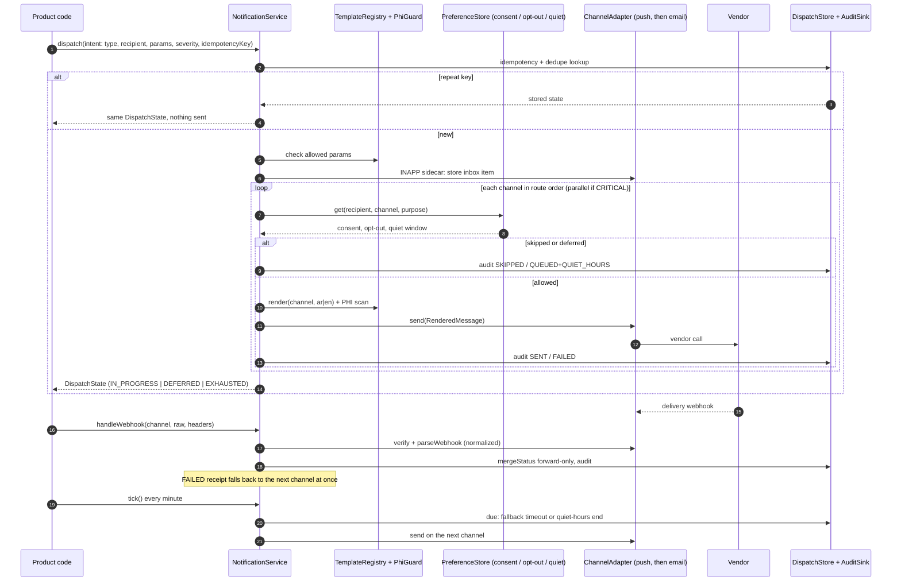

# Notification layer (`@kiorex/contracts/notify`, since 1.7.0)

One shared, pure-TypeScript layer that sits **above** the per-channel adapters (SMS, Email, WhatsApp, Push, in-app inbox) of every Kiorex product. A product says *what happened and to whom* (an intent); the layer decides **which channels, in which order, with which words, and whether it is allowed**, then hands a rendered message to the product's own adapter and records one audit shape.

It is a **package, not a service** (founder decision): no network hop, no shared database, no new deployable. Each product injects its own adapters, preference store, audit sink and clock. Nothing in the package performs I/O.

```ts
import { NotificationService, TemplateRegistry, simpleTemplate, MockChannelAdapter } from "@kiorex/contracts/notify";
```

Subpath export (ESM + CJS + types; `typesVersions` covers `moduleResolution: node`). Source: `src/notify/`. Tests: `test/notify/` (100 % statements, branches, functions, lines).

- [What it is](#what-it-is)
- [Interface](#interface)
- [Template model](#template-model)
- [PHI-free guard](#phi-free-guard)
- [Routing and fallback](#routing-and-fallback)
- [Consent, preferences, quiet hours, WhatsApp window](#consent-preferences-quiet-hours-whatsapp-window)
- [Status model](#status-model)
- [Audit record](#audit-record)
- [ChannelAdapter](#channeladapter)
- [Testing with mocks](#testing-with-mocks)
- [Sequence](#sequence)
- [Adoption: kiorex-platform (done)](#adoption-kiorex-platform-done)
- [Migration order](#migration-order)

## What it is

| Layer | Owns | Does not own |
|---|---|---|
| **Notification layer** (this package) | intent, templates and their allowed params, PHI guard, routing and fallback, consent / opt-out / quiet-hours / WhatsApp-window gate, idempotency and dedupe, normalized status, audit shape | sending, vendor wire formats, queues, tables |
| **Channel adapters** (per repo) | the HTTP call to the SMS / email / WhatsApp / push vendor, vendor webhook signature, mock mode | deciding whether or when to send |
| **Product** | the preference store (consent and opt-out tables), the audit table, the schedule that calls `tick()`, mapping its domain events to intents | rendering rules |

## Interface

```ts
type Channel  = "SMS" | "EMAIL" | "WHATSAPP" | "PUSH" | "INAPP";
type Severity = "ROUTINE" | "IMPORTANT" | "CRITICAL";

interface NotificationIntent {
  type: string;                      // template code, e.g. APPOINTMENT_REMINDER
  recipient: { id: string; phone?: string; email?: string; deviceIds?: string[]; locale: "ar" | "en" };
  params?: Record<string, string | number>;   // only keys the template declares
  severity: Severity;
  idempotencyKey: string;            // same key = same notification, never sent twice
  dedupe?: { key: string; windowMs?: number }; // same recipient+type+key inside the window is suppressed (default 24 h)
  channels?: Channel[];              // restrict routing; channels outside the severity route are appended in the given order
  metadata?: Record<string, string>; // PHI-free pass-through to adapters and audit (booking id, message id)
}

const svc = new NotificationService({ adapters, registry, preferences, audit, clock?, routing?, store?, newId? });
await svc.dispatch(intent);                       // -> DispatchState (phase, attempts[], nextActionAt)
await svc.tick();                                 // run due fallbacks and quiet-hours deferrals (call every minute)
await svc.applyStatus("SMS", { providerRef, status: "DELIVERED" });
await svc.handleWebhook("SMS", rawBody, headers); // verify + parse + apply -> { verified, applied, ignored }
```

`dispatch` never throws for a delivery problem; it returns a `DispatchState`:

| `phase` | Meaning |
|---|---|
| `IN_PROGRESS` | at least one channel accepted the message and no delivery receipt yet (or more channels to try) |
| `DEFERRED` | quiet hours: `nextActionAt` is when `tick()` will resume |
| `DELIVERED` | some channel reached DELIVERED or READ |
| `EXHAUSTED` | every channel was skipped or failed, or the last channel timed out |
| `SUPPRESSED` | dedupe hit |

Injected collaborators:

| Collaborator | Interface | Provided by |
|---|---|---|
| adapters | `ChannelAdapter[]` | each repo wraps its existing provider (see below) |
| preferences | `PreferenceStore.get(recipientId, {channel, purpose}) -> {optedOut?, consent?, quiet?, whatsappLastInboundAt?}` | product tables |
| audit | `AuditSink.write(AuditRecord)` | product table, outbox or log |
| store | `DispatchStore` (idempotency, dedupe, provider-ref index, due list). `MemoryDispatchStore` is bundled (tests, single process); production needs a table so `tick()` and webhooks survive restarts | product |
| clock | `{ now(): number }` | `Date.now` or a fake |

## Template model

`TemplateRegistry` holds one `TemplateDefinition` per intent type:

```ts
registry.register({
  type: "APPOINTMENT_REMINDER",
  purpose: "REMINDER",                          // TRANSACTIONAL | REMINDER | MARKETING | SECURITY: selects the consent asked of the store
  allowedParams: ["doctor", "time", "bookingId"], // PHI-free guard: nothing else is accepted
  requiredParams: ["doctor", "time"],
  quietBypass: false,
  channels: {                                   // channel-specific renderers; each receives the locale
    SMS:      (c) => ({ text: c.t(c.locale === "ar" ? "تذكير: زيارتك مع {doctor} في {time}." : "Reminder: visit with {doctor} at {time}.") }),
    EMAIL:    (c) => ({ subject, html, text }),
    WHATSAPP: (c) => ({ template: { name: "appt_reminder", language: c.locale, vars: { doctor, time } } }), // or { text } (24 h window only)
    PUSH:     (c) => ({ title, body, data: { deepLink: "kiorex://bookings/b1" } }),
    INAPP:    (c) => ({ title, body, deepLink }),
  },
});
```

- `simpleTemplate({ type, purpose, en, ar, ... })` builds all channels from one ar/en pair (the common case).
- A channel the template does not declare is `SKIPPED` with reason `NO_TEMPLATE` and routing moves on.
- SMS bodies are measured (`smsSegments`: GSM-7 160/153, UCS-2 70/67 per part). Over `smsMaxSegments` (template, else registry default 4) the attempt is `FAILED` `SMS_TOO_LONG`.
- `registry.validate()` renders every channel in both locales with `sampleParams` and flags failures or identical ar/en output. Run it in the product's unit tests.
- What an adapter receives is a `RenderedMessage`: `{ notificationId, channel, to, type, locale, body, severity, attempt, metadata }` where **`body` holds the channel payload** (`{text}`, `{subject,html,text}`, `{template|text}`, `{title,body,data}`, `{title,body,deepLink}`).

## PHI-free guard

Two layers, both fail closed:

1. **Declared params.** An intent may only carry the keys the template lists in `allowedParams`; anything else is rejected before any rendering (`PARAM_NOT_ALLOWED`, intent-level audit record, nothing sent). Required keys missing: `PARAM_MISSING`.
2. **Pattern scan.** After rendering, SMS, push and WhatsApp bodies (text, title, data values except links, template vars) are scanned by `PhiGuard`. A hit fails that attempt with `PHI_BLOCKED` and the detail lists the pattern codes. Defaults (`DEFAULT_PHI_PATTERNS`): national id (14 digits), MRN, lab values with units, diagnosis terms (en and ar, whole word), prescription wording. Pass your own list: `new TemplateRegistry({ phiGuard: new PhiGuard([...]) })`. Email and in-app are authenticated surfaces and are not scanned, which is why clinical detail belongs there and a push only says "open the app".

The audit record never contains a body, a param or a raw address.

## Routing and fallback

`RoutingPolicy` maps severity to an ordered channel list:

| Severity | Default route | Behaviour |
|---|---|---|
| ROUTINE | INAPP, PUSH, EMAIL | sequential, fall back after 15 min without a delivery receipt |
| IMPORTANT | INAPP, PUSH, WHATSAPP, SMS | sequential, fall back after 5 min |
| CRITICAL | INAPP, PUSH, WHATSAPP, SMS, EMAIL | **all at once** (parallel), quiet hours bypassed |

Rules:

- **INAPP is a sidecar.** If the route contains it, the inbox item is written first and independently; it never counts as "reached the person" and never stops the chain.
- **Sequential.** The head of the chain is tried; a `SKIPPED` (no consent, opt-out, no address, no template, no adapter) or `FAILED` attempt moves to the next channel **immediately**. A `SENT` attempt waits `fallbackAfterMs` for a `DELIVERED` / `READ` receipt; `tick()` then tries the next channel (the first attempt stays `SENT`, a late receipt still counts). A `FAILED` receipt falls back at once. When the last channel times out the dispatch closes as `EXHAUSTED`; a late receipt can still turn it `DELIVERED`.
- **No timers inside the package.** Fallback and deferral are due times stored in the `DispatchStore` (`nextActionAt`); the product calls `tick()` on its own schedule. This keeps the layer pure and testable with a fake clock.
- **Idempotency.** The same `idempotencyKey` returns the stored `DispatchState` and sends nothing. `dedupe` suppresses a logically identical notification arriving under a different key.
- Override per product: `new NotificationService({ routing: { ...DEFAULT_ROUTING, ROUTINE: { channels: ["PUSH"], fallbackAfterMs: 600_000 } } })`.

## Consent, preferences, quiet hours, WhatsApp window

Evaluated per channel, in this order, by `evaluateGate` (pure, exported):

1. **Consent** for the template `purpose` (`pref.consent === false`): `SKIPPED CONSENT`.
2. **Opt-out** of the channel (`pref.optedOut`): `SKIPPED OPT_OUT`.
3. **Quiet hours** (`pref.quiet = {startHour, endHour, tzOffsetMinutes}`, wraps midnight): the dispatch is `DEFERRED` until the window ends (audit: `QUEUED` + `QUIET_HOURS` + `deferredUntil`). **Not applied** to INAPP, to `CRITICAL`, or to a template with `quietBypass`. Consent and opt-out still apply to CRITICAL.
4. **Address.** No phone / email / device token: `SKIPPED NO_ADDRESS` (the reason is recorded, the chain continues).
5. **WhatsApp 24 h window.** Free text is allowed only when `whatsappLastInboundAt` is within 24 h. Outside it only the approved `template` goes (free text is dropped); a text-only renderer is `SKIPPED WHATSAPP_WINDOW`.

## Status model

`DeliveryStatus`: `QUEUED`, `SENT`, `DELIVERED`, `READ`, `FAILED`, `SKIPPED`.

- `mergeStatus(current, next)` is forward-only: QUEUED < SENT < DELIVERED < READ; FAILED applies only before delivery; FAILED and SKIPPED are terminal. Retries and out-of-order webhooks are therefore idempotent.
- `normalizeVendorStatus(channel, raw)` (and `normalizeSmsStatus`, `normalizeEmailStatus`, `normalizeWhatsAppStatus`, `normalizePushStatus`, `normalizeInAppStatus`) map vendor words (`DELIVRD`, `undelivered`, `processed`, `bounce`, `open`, `invalid_token`, `read`, ...) to the model; an unknown word returns `undefined` and is dropped, never guessed.
- `parseNeutralStatusBody(channel, raw)` parses the provider-neutral webhook `{ "events": [{ "id", "status", "error?", "occurredAt?" }] }` that every repo already documents in its `Docs/PROVIDERS.md`.

## Audit record

One shape for every product (`AuditRecord`): `id, at, notificationId, idempotencyKey, intentType, severity, recipientId, channel (null for intent-level), status, reason?, detail?, attempt, locale, providerRef?, addressMasked?, mode?, deferredUntil?`. Written once per channel attempt and once per status change; PHI-free by construction. Reasons: `CONSENT, OPT_OUT, NO_ADDRESS, WHATSAPP_WINDOW, NO_TEMPLATE, NO_ADAPTER, DEDUPED, QUIET_HOURS, PHI_BLOCKED, SMS_TOO_LONG, PARAM_NOT_ALLOWED, PARAM_MISSING, RENDER_ERROR, SEND_FAILED, ADAPTER_ERROR, DELIVERY_FAILED, TIMEOUT, UNKNOWN_TYPE`.

## ChannelAdapter

```ts
interface ChannelAdapter<C extends Channel = Channel> {
  readonly channel: C;
  readonly mode: "mock" | "real";
  send(message: RenderedMessage<C>): Promise<{ ok: boolean; providerRef?: string; error?: string }>;
  parseWebhook(rawBody: string, headers?: Record<string, unknown>): StatusEvent[]; // normalized, unknown statuses dropped
  verify(rawBody: string, headers?: Record<string, unknown>): boolean;             // vendor signature
}
```

Existing per-repo adapters implement it by delegation: `send` calls the current provider client, `parseWebhook` calls the current vendor mapping and runs the result through `normalizeVendorStatus`, `verify` calls the current signature check. A push channel with several devices is sent once per device; the attempt succeeds if any device accepts and carries one `providerRef` per device. Adapter exceptions are contained (`ADAPTER_ERROR`). The in-app channel is an adapter too: `send` stores the inbox item.

## Testing with mocks

`MockChannelAdapter` (one per channel, `createMockAdapters()`) records every send, supports `failNext(n, code)`, `failTo` (recipients that bounce), `throwOnSend`, speaks the neutral webhook body and verifies the header `x-mock-signature: mock-secret`. Pair it with a fake clock to test fallback timing without sleeping. See `test/notify/harness.ts`.

## Sequence



## Adoption: kiorex-platform (done)

`kiorex-platform` consumes the vendored tarball `vendor/kiorex-contracts-1.7.0.tgz` (same mechanism as the rest of `@kiorex/contracts`).

- `apps/api/src/messaging/notification.bridge.ts`: `HubChannelAdapter` (implements `ChannelAdapter` over `MessagingHub`, which still owns the `MessageLog` row, the mock/real choice and the vendor mapping) and `InboxChannelAdapter`.
- `apps/api/src/engagement/notification.layer.ts`: the 25 `NotifyKind` templates as a `TemplateRegistry` (same copy), the Prisma-backed `PreferenceStore` (consent, `NotificationPreference`, quiet hours), and `outcomeOf` which maps a `DispatchState` back to the engagement statuses (`SENT`, `SKIPPED_CONSENT`, `SKIPPED_OPTOUT`, `DEFERRED`, `FAILED`).
- `EngagementService.deliver()` now calls `NotificationService.dispatch` with a single-channel intent (the engagement queue still owns scheduling and its `Message` rows). Behaviour in mock and log mode is unchanged.
- The in-app inbox already existed (`Message` rows with channel `INAPP`, `GET /inbox`), so **no table or migration was added**; it is now a first-class channel in the layer and `inbox()` renders through the registry.
- `MessagingHub.handleStatusWebhook` normalizes vendor statuses with `normalizeVendorStatus` and applies them with `mergeStatus`.
- Platform specifics: params not declared by a template are dropped before dispatch (callers historically passed extras); the platform sets `smsMaxSegments: 20` so no legacy SMS is newly rejected; a PHI hit now fails the attempt as `PHI_BLOCKED:<code>` instead of sending.

## Migration order

Do not migrate several products at once; each step is one repo, behind unchanged public behaviour, with its own tests green before the next.

| # | Repo | Why this order | Work |
|---|---|---|---|
| 1 | **kiorex-platform** | has the hub, mappings, consent, quiet hours and an inbox already | **Done** (above) |
| 2 | **Passport** (`kiorex-account`) | smallest surface: OTP over WhatsApp then SMS fallback is exactly the layer's IMPORTANT/CRITICAL route; today `notify.ts` and `provider.ts` | one `SECURITY` template (code never in audit, `quietBypass`), adapters wrapping `provider.ts`, `DeliveryStatus.handleWebhook` becomes `svc.handleWebhook`. OTP bodies are sent but never audited |
| 3 | **kiorly-lab** | has `messaging-provider.ts`, `push-provider.ts` and critical-result alerts (the CRITICAL fan-out case) | critical lab alert = CRITICAL intent; result-ready = IMPORTANT with an app-only push (PHI guard enforces "open the app") |
| 4 | **kiorly-pharmacy** | same provider layout as lab; order-ready, refill reminder, consent-gated dispensing | REMINDER / TRANSACTIONAL templates; wire the existing consent registry into `PreferenceStore` |
| 5 | **clinics-management** | largest and most entangled (`apps/api/src/messaging`: appointment outbox, reminder scheduler, email outbox, digests, WhatsApp replies, MS-03 consent) | migrate one flow at a time behind the outbox: appointment reminders first, then transactional email, then installment reminders and digests; keep its `OutboundMessage` worker as the `DispatchStore`-backed scheduler that calls `tick()` |

Per-repo checklist: implement `ChannelAdapter` over the existing client; port templates with explicit `allowedParams`; implement `PreferenceStore` over the product's consent and opt-out tables; persist `DispatchStore` and `AuditSink` (one table each); call `tick()` from the existing job runner; run `registry.validate()` in unit tests; vendor `@kiorex/contracts` 1.7.0 or newer.

Back to the [README](../README.md) · [Docs index](INDEX.md)
